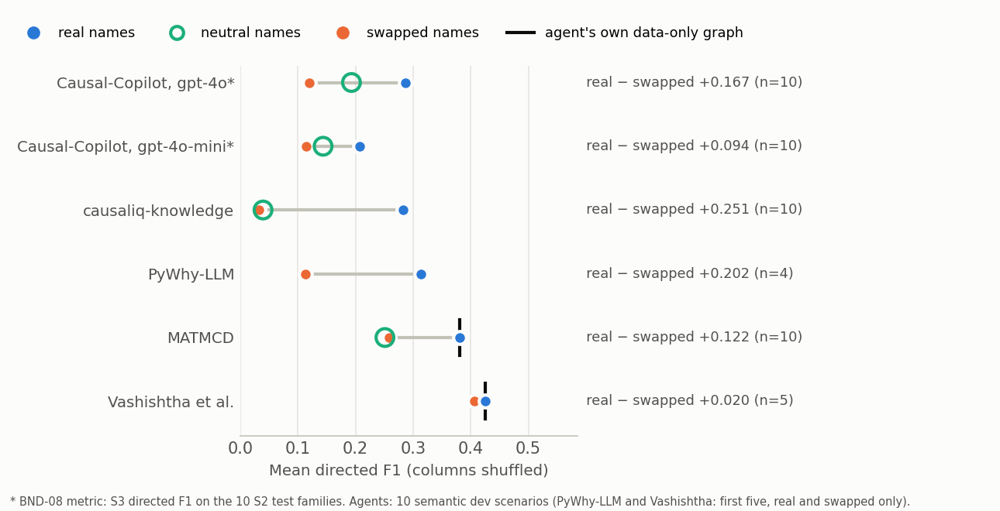

# AB-06 Field audit: name reliance across LLM-using causal-discovery systems (results)

Tickets: AUD-38 (also STR-01, RQ-05). Pre-registration: `plans/ab06_prereg.json`, written before any live grid call, plus
three amendments, each written before the result it touches:

| Amendment | What it did |
|---|---|
| 1 | Cut Vashishtha et al. to five scenarios after its cost was measured |
| 2 | Made quota stops resumable |
| 3 | Fixed the scorer's file selection and recorded one failure as found |

Every manifest is kept in `manifests/evidence/ab06_prereg*_2026-10-14.sha256`. The runs are Uzair's, 14 Oct, tier A: 79
of 80 ok, $32.11. Scored by `analysis/ab06_score.py` → `analysis/results/ab06/ab06.json`. The figure is
`analysis/ab06_figure.py` → `analysis/results/ab06/name_reliance.png`.

## Where we are now

**Both predictions are supported.**

| | Claim | Result | Verdict |
|---|---|---|---|
| P9 | Name reliance is common: ≥ 3 of the 5 systems lose ≥ 0.10 directed F1 from real to swapped names | causaliq-knowledge **0.251**, Causal-Copilot on gpt-4o **0.167**, MATMCD **0.122**; Vashishtha et al. 0.020. PyWhy-LLM 0.202 on 4 pairs is not entered (needs 5) | **supported** (3 of 4 entered) |
| P10 | Knowledge can make an agent worse than its own data-only output (DV-1 precision, real names) | MATMCD **0.686** against its own PC graph's **0.720**; Vashishtha 0.720 against 0.718 | **supported** (MATMCD) |

**Reading:**

- Name reliance is common. Every system that lets the model decide connections loses at least 0.10 when the names are
  wrong. That covers the names-only systems (causaliq, PyWhy-LLM) and the hybrids that let the model veto or add edges
  (MATMCD, Causal-Copilot).
- The one system that resists, Vashishtha et al., is the one whose final graph is decided by the data. PC's arrows are
  kept, and the model's order only orients the few pairs PC leaves open: 11 of 100 arrows, `llm_order`. Its loss is 0.020.
- Vashishtha resists by construction, not because its model is right. 84% of its triplet answers are cut off by its own
  token limit, so the model has little to say in any arm.
- This is the pre-stated "design property" reading. Name reliance comes from where knowledge is allowed to act, not from
  which model is used. The orient-only rule of the claim ledger (approach v1, G5) is the principled form of what
  Vashishtha's pipeline does by accident.

## Per system and arm (mean directed F1 under the expectation rule; DV-1 = committed-claim precision)

"Nothing moves" (the empty graph) scores DV-1 0.670 on these 10 scenarios.

| System | Arm | Runs ok | Directed F1 | DV-1 precision | Cost |
|---|---|---|---|---|---|
| causaliq-knowledge (names only) | real | 10 | 0.283 | 0.713 | $0.06 |
| | neutral | 10 | 0.040 | 0.657 | $0.05 |
| | swapped | 10 | 0.032 | 0.653 | $0.06 |
| PyWhy-LLM (names only) | real | 5 | 0.314 | 0.545 | $5.00 |
| | swapped | 4 (1 failed) | 0.114 | 0.435 | $4.95 |
| MATMCD (PC + LLM constraints) | real | 10 | 0.380 | 0.686 | $3.23 |
| | neutral | 10 | 0.251 | 0.662 | $2.95 |
| | swapped | 10 | 0.259 | 0.659 | $3.23 |
| | *its own PC graph (data only)* | | *0.381* | *0.720* | |
| Vashishtha et al. (PC + LLM order) | real | 5 | 0.426 | 0.720 | $6.09 |
| | swapped | 5 | 0.406 | 0.719 | $6.50 |
| | *its own PC graph (data only)* | | *0.425* | *0.718* | |
| Causal-Copilot, gpt-4o (BND-08 metric) | real / neutral / swapped | 10 / 10 / 10 | 0.287 / 0.193 / 0.120 | | |
| Causal-Copilot, gpt-4o-mini (RQ-17) | real / neutral / swapped | 10 / 10 / 10 | 0.208 / 0.144 / 0.114 | | |

**MATMCD falls below its own data in every arm.**

- Real names leave F1 where PC put it (0.380 against 0.381), but DV-1 drops (0.686 against 0.720).
- Neutral and swapped names push it far below: 0.251 and 0.259, below its own PC graph in 9 and 8 of 10 scenarios, and
  below "nothing moves" on DV-1.
- The mechanism is in its code. A model "No" in both directions forbids the edge, so the final PC run deletes true
  connections the data had found. This is exactly what invariant I5 ("knowledge never removes a connection") rules out.

**The names-only systems carry little decision value even with real names.** PyWhy-LLM's DV-1 (0.545) is well below
"nothing moves" (0.670). causaliq-knowledge reaches 0.713 by committing few edges.

**Provenance.**

| System | What the run record shows |
|---|---|
| causaliq-knowledge, PyWhy-LLM | 100% of arrows from the model |
| Vashishtha et al. | 89% from PC, 11% from the LLM order |
| MATMCD | Every arrow is attributed to the model by the adapter's rule, because its constraint matrix covers every pair, but its real-arm graph equals PC's in F1. Provenance as these tools record it does not say where a direction came from |
| Causal-Copilot | Records no per-edge source at all (AB-11) |

## Failures and spend

- 1 of 80 runs failed: PyWhy-LLM, conveyor, swapped. Its `guidance` library rejected a negative time-to-first-token
  (−1.04 s), i.e. it crashes when the host clock steps backwards. This is counted as an agent failure, as the
  pre-registration says (amendment 3). P9 does not depend on it.
- Tier A cost $32.11, under the $48 estimated in amendment 1, because Vashishtha's tie share was lower on the larger
  scenarios.
- AB-06 in all: $32.11 grid + $0.86 Causal-Copilot arm. AB-05 probes: $3.79.
- Tier B (PyWhy-LLM and Vashishtha neutral, plus their other five scenarios, about $87) was not run. No verdict needs it.

## Where we're going

- L2 (field-level name reliance) is now a measured headline, scoped as above. It goes to the AB-16 decision and onto site
  page 6.
- EXT notes: the MATMCD mechanism and the PyWhy-LLM clock crash join the drafts for maintainers.
