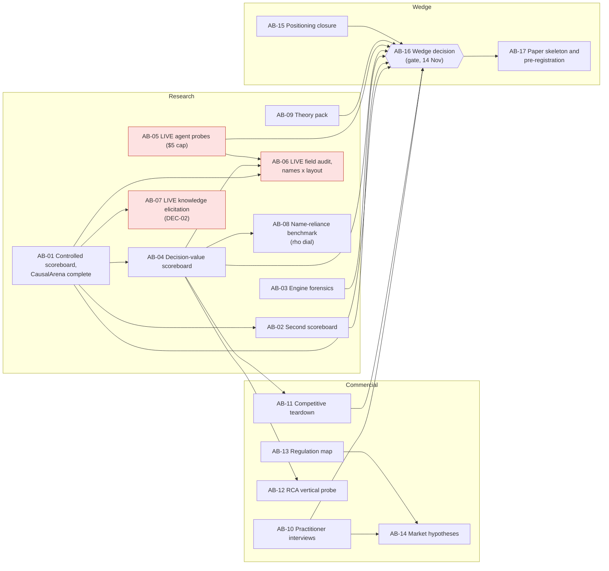

# Audit program DAG: research landscape, commercial landscape, wedge and paper

Ticket: AUD-32. Plan file: `plans/audit_dag.json` (generated by `plans/make_audit_dag.py`, checked by
`tracker/plan_check.py plans/audit_dag.json`). Drafted 2026-10-12. **Status: proposed, awaiting Uzair's approval.**
Nothing below runs until approved; the three live bundles also need their own spend approval.

## Where we are

The desk audits (AU1-AU8, AU0) and the free steps (AUD-27..31, BLD-13; `analysis/reports/aud27_31_free_steps.md`) give
three findings that a paper could stand on, each with measured support on one benchmark:

| Wedge | Claim | Evidence so far |
|---|---|---|
| W1 Controlled scoring | Published causal-discovery scores read the column layout through three separate channels: the authors' orientation rule, PC's conflict rule, and engine copies with a one-sided search | CausalArena: FCI +0.2 F1 from the authors' rule; PC 0.07 F1 worse in released order; Causal-Copilot's PC copy wrong on 36% of perfect-information problems |
| W2 Decision value | On the question users ask ("if I set T, does Y move?"), learned graphs barely beat "nothing moves", while the data-only ceiling is near perfect | CausalArena semantic: empty graph 0.643, best method (GES) 0.753, true CPDAG 1.000 at 92.5% coverage; ancestor AID: no method beats the empty graph |
| W3 Claim ledger | A record format and verifier that make the failures above visible: every direction typed by source, knowledge never adds a connection, order invariance declared | Format, JSON Schema and verifier written; 9 tests pass; no engine yet |

Name reliance (Causal-Copilot 0.306 -> 0.142 directed F1 with swapped names) is the fourth strand; it is measured for one
system only.

## What "landmark" means here (criteria the DAG is built to test)

| | Criterion | Status 12 Oct |
|---|---|---|
| L1 | Layout and engine channels move a published score by >= 0.05 F1 or a top-10 rank, on two public scoreboards | Met on one (CausalArena) |
| L2 | >= 3 of >= 5 LLM-using systems lose >= 0.10 directed F1 from real to swapped names (columns shuffled), with a dose-response curve | 1 system measured |
| L3 | On >= 2 benchmarks with interventions, most methods are within 0.05 of "nothing moves" while the identifiable ceiling is >= 0.15 above the best | Met on CausalArena (both families) |
| L4 | A constructive system: never below its data-only output, bounded harm under swapped names, decision-value precision >= 0.05 above the best reproduced method at stated coverage, calibration error <= 0.05, on >= 2 benchmarks | Format and verifier only |
| L5 | Theory that explains the measurements (F1 = S x a and the error budget, bounded harm, conflict-rule order dependence, the decision-value ceiling) | Identity checked numerically |
| C1 | Practitioners name decisions where provenance and abstention matter | Not started |
| C2 | One vertical where order knowledge plus abstention measurably beats learned graphs | Not started |
| C3 | A regulatory or standards hook that rewards the ledger's guarantees | Desk material in AU5/AU8 |

A measurement paper needs L1 + L3 on two benchmarks plus L5; L2 makes it a field-level result; L4 turns it into a
methods paper. C1-C3 decide whether a product angle is worth carrying.

**Kill criteria (written before the runs).** If no agent loses >= 0.10 with swapped names (P9 refuted), L2 is dropped
as a headline and the paper leads with L1 + L3. If most methods clearly beat "nothing moves" on a second benchmark (P6
refuted), L3 becomes a CausalArena-specific note. If no interviewee values provenance or abstention (P13 refuted), the
product angle is shelved and the paper stands on L1-L3.

## The DAG

Longest dependency chain: AB-01 -> AB-04 -> AB-11 -> AB-16 -> AB-17. Milestones: **AM-1** (28 Oct) controlled
scoreboard and decision value; **AM-2** (14 Nov) wedge decision; **AM-3** (21 Nov) paper skeleton and pre-registration.
AB-06, AB-07, AB-08, AB-12 and AB-14 feed the gate when they finish, but the gate does not wait for them; it decides on
interim results if needed.

| Bundle | Track | Needs | Window | Cost | Run by | Serves | Prediction (refuted if) |
|---|---|---|---|---|---|---|---|
| AB-01 Controlled scoreboard complete | research | | 12-17 Oct | none | Claude | L1 | P1 GIES with targets gains < 0.01 from shuffling, expectation rule (> 0.05); P2 PC-maxP released vs shuffled within 0.01 in all families (> 0.03 in any) |
| AB-02 Second scoreboard | research | AB-01 | 14-24 Oct | none | Claude | L1 | P3 a release orders columns by causal order (both tau < 0.1); P4 the conflict-rule effect appears there (abs. delta q < 0.03) |
| AB-03 Engine forensics | research | | 14-24 Oct | none | Claude | L1, L4 | P5 another widely used engine fails the perfect-oracle test (all others 100%) |
| AB-04 Decision-value scoreboard | research | AB-01 | 14-28 Oct | none | Claude | L3 | P6 at most two methods beat "nothing moves" by > 0.05 on every benchmark (four or more do); P7 ceiling >= 0.15 above best (< 0.05 anywhere) |
| AB-05 Agent probes | research | | 14-20 Oct | **$5 cap** | **Uzair** | L2 | P8 >= 3 of 5 agents run end to end (one or none) |
| AB-06 Field audit, names x layout | research | AB-01, AB-04, AB-05 | 21 Oct-14 Nov | **set by AB-05** | **Uzair** | L2 | P9 >= 3 agents lose >= 0.10 with swapped names (none does); P10 one agent falls below its own data-only output (all at or above) |
| AB-07 Knowledge elicitation (A3) | research | AB-01 | 16-28 Oct | **~900 short calls (DEC-02)** | **Uzair** | L2, L4 | O1-O5 as pre-registered in program v2 |
| AB-08 Name-reliance benchmark | research | AB-04 | 21 Oct-14 Nov | none to build | Claude | L2, L3 | P11 F1 falls monotonically in rho (no trend) |
| AB-09 Theory pack | research | | 15 Oct-7 Nov | none | Claude | L5 | P12 every statement holds on all 500 public files (any counterexample) |
| AB-10 Practitioner interviews | commercial | | 14 Oct-7 Nov | none | **Uzair** interviews; Claude prepares | C1 | P13 half name a decision where "which causes, how sure" matters more than the graph (under a quarter) |
| AB-11 Competitive teardown | commercial | AB-04 | 15-31 Oct | none | Claude | C1, L4 | P14 no tool records a per-direction source (any does) |
| AB-12 RCA vertical probe | commercial | AB-04 | 20 Oct-7 Nov | none | Claude | C2 | P15 declared topology + abstention beats learned-graph RCA on AC@3 by >= 0.1 (< 0.03) |
| AB-13 Regulation map | commercial | | 14-24 Oct | none | Claude | C3 | desk map |
| AB-14 Market hypotheses | commercial | AB-10, AB-13 | 27 Oct-12 Nov | none | Claude | C3 | estimates with inputs |
| AB-15 Positioning closure | wedge | | 12-22 Oct | none | Claude | L1-L5 | novelty matrix |
| AB-16 Wedge decision | wedge | 9 bundles | 3-14 Nov | none | **Uzair decides** | all | decision (DEC-05) |
| AB-17 Paper skeleton | wedge | AB-16 | 10-21 Nov | none | Claude | L1-L5 | manifest hashed before held-out runs |

Each bundle's parts, gates, must-show list, risks and proposed ticket are in `plans/audit_dag.json`.

## How the DAG covers what was asked

- **Research landscape:** AB-01..AB-04 measure scoreboards and engines; AB-05/06 extend the name-reliance result to the
  field; AB-07 answers what a model can supply; AB-09 is the theory; AB-15 closes the novelty search.
- **Our own benchmark:** AB-08 (decoupled semantics with a rho dial, ArenaShuffle overlay), scored with AB-04's metrics.
- **Theoretical and practical limits:** AB-04 measures the identifiable ceiling and adds the usefulness threshold (the
  precision at stated coverage where acting on a learned graph beats acting on "nothing moves" or a declared topology,
  priced with interview costs); AB-09 proves the ceiling.
- **Core engines:** AB-03 finds which engines can be reused as-is; the build itself is the Q2 work AB-16 sets.
- **Commercial landscape and packaging:** AB-10..AB-14, with AB-11 testing open tools against the ledger verifier.
- **Wedge:** AB-16 scores L1-L5 and C1-C3 on the evidence and picks the paper spine and venue; AB-17 freezes it.

## What needs Uzair

1. Approve the DAG (or edit it). On approval: tickets AUD-33..47 and DEC-05 enter the catalogue, each bundle's closes
   list is filled, and the free bundles start (AB-01, AB-03, AB-09, AB-13, AB-15 first; they need nothing).
2. AB-05: approve a $5 total cap for one probe run per agent; you run the plan files.
3. AB-07: decide DEC-02 (about 900 short calls).
4. AB-10: recruit 5-8 practitioners and run the interviews; check with course staff whether informal interviews need
   human-subjects review before starting.
5. AB-06's budget is proposed in the AB-05 report; nothing is spent before you approve it.

## Relation to the Q1 plan

Runs alongside `plans/q1_dag.json`. BND-12's second-model part moves into AB-06; AB-07 is DEC-02 (A3); AB-16 feeds
DEC-01. Q1 deliverables keep their own dates.
