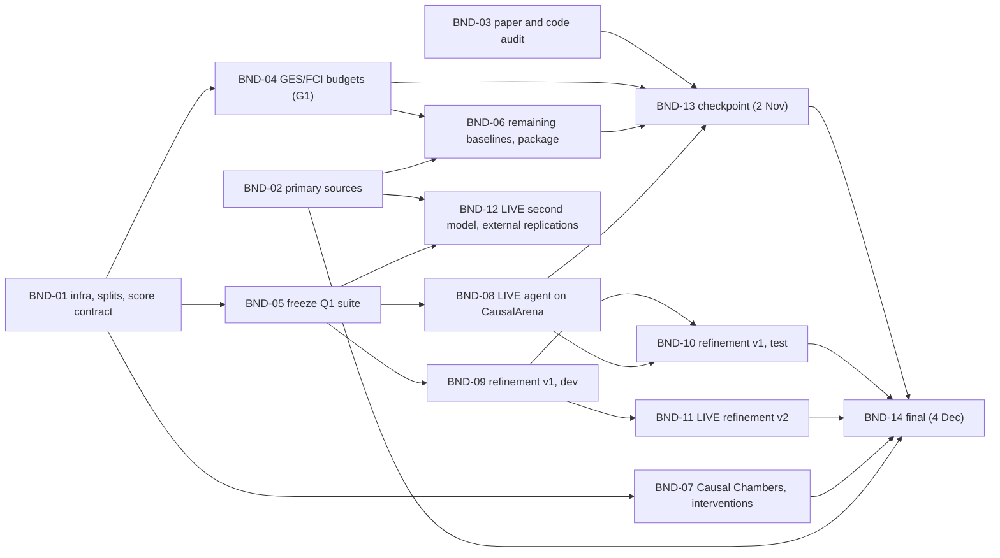

# Quarter 1 execution plan: bundles as a DAG

Tickets: DLV-01 to DLV-06; REP-03, REP-04, REP-06, REP-07, REP-09 to REP-13; DOM-05 to DOM-12; AUD-10 to AUD-15; BEN-07 to BEN-12;
EVL-01 to EVL-03, EVL-05; CAP-06, CAP-10, CAP-17; INF-04 to INF-07; TGT-09, TGT-13; BLD-06; RQ-16, RQ-17.

Status: proposed, 10 Oct 2026. Machine-readable form: `plans/q1_dag.json`, checked by `python tracker/plan_check.py`
(IDs, dependencies, no cycles, every in-scope ticket closed by exactly one bundle, dates against dependencies, due dates and
milestones, and an approval flag on every bundle that spends API credit). It currently passes with no errors.
This plan replaces bundles 2 to 5 of `bundle2_onward_design.md`; their content is kept and renumbered below.

## 1. Scope

| Asked for | Tickets | Closed in |
|---|---|---|
| In-flight items | REP-03, REP-04, EVL-01..03, CAP-17, DLV-01..03, TEAM-01, TEAM-02, TEAM-07 | BND-01, 03, 05, 06, 08, 13, 14 |
| Quarter 1 deliverables | DLV-01..06 | BND-05, 08, 11, 13, 14 |
| Replication | REP-03, 04, 06, 07, 09, 10, 11, 12, 13 | BND-02, 03, 04, 06, 07, 12, 14 |
| Domain exploration | DOM-05..12 | BND-01, 02, 06 |
| Existing-capability audit | AUD-10..15; BEN-07..12 | BND-03, 04, 05, 06, 07, 08, 12 |
| Needed to close the above | INF-04..07, EVL-05, RQ-16, RQ-17, CAP-06, CAP-10, TGT-09, TGT-13, BLD-06 | as listed per bundle |

Outside every bundle: TEAM-01 (its "Proposed project" part waits on DEC-01; it is updated in BND-13), and TEAM-07 (it closes
when you send the prod digest draft already sitting in #causal-discovery).

Not in Quarter 1: the program-v2 ledger (BLD-02 to BLD-05), the knowledge-tier route (DEC-02: RQ-10 to RQ-14, CAP-04,
TGT-07), what-if answers and experiment choice (BLD-07, BLD-08). G1 on 16 Oct confirms or changes this.

## 2. How the plan is built

**Each bundle is a ticket.** On approval each bundle becomes a dev ticket (new prefix `BND`, category "16 Bundles", dev-only).
Its links go into `links.txt`: `BND-x blocks BND-y` for the DAG, and `BND-x implements T` for every ticket it closes. Two things
follow automatically:

- `trace.py` checks the DAG for cycles on every run (T3).
- One new rule will be added: a bundle may not be marked done while a ticket it implements is not.

**Each bundle is verifiable in one run.** It has a must-show list, pre-registered predictions with thresholds that go into
code before the run, and gates. "Done" means the must-show items exist as files and the tracker checks on them pass.

**Who runs what:**

- Claude runs everything that spends nothing.
- No-cost jobs too long for the sandbox's 180 s steps go through a new `cc.ps1 compute` command. You start it once per job file.
  Its container has no `.env` and no key, so it cannot spend.
- Every bundle that calls the model is marked LIVE. You approve it and you start it, after a free stub run has measured its cost.

## 3. Axes, and when each is bound

| Axis | Values | Bound when | By |
|---|---|---|---|
| Split | dev / test, by sha256 of the scenario ID; bundle-1 and pass-4b data are dev | BND-01, before any tuning | `plans/splits.json`, pinned |
| Suite | S1 (Sachs + 4 bundle-1 families, already run) and S2 (10 CausalArena test scenarios, columns shuffled) | BND-05 | suite manifest, pinned; a change reopens DLV-01 |
| Regime | D, D+I, D+K, D+I+K | written into every score row | `score_record.py` (EVL-01) |
| Controls | columns shuffled or not; names real, neutral or swapped; data supplier | written into every score row | `score_record.py` (EVL-02) |
| Metrics | directed F1, skeleton P/R/F1, direction accuracy, SHD (definition named), coverage, calibration, cost, time | written into every score row | `score_record.py` (EVL-03) |
| Refinement rule | v1 thresholds 0.5 / 0.9 / modal type; calibration from DOM-08 | end of BND-09, before any test file is read | rule file sha256 plus an access log |
| Model and snapshot | GPT-4o (snapshot recorded per call); second model chosen by you | at run time | `meta.json` per run |
| Predictions | M1-M5, Q4a-c, R1-R6, S1-S2 | in code before each live or compute run | hashed plan files |

## 4. Failure modes named in advance

| Code | Failure | Guard |
|---|---|---|
| F1 | A compute job dies at the step limit | chunked, resumable jobs; gate J1 checks that a resumed job ends with an identical output hash |
| F2 | A no-cost job spends credit by accident | the compute container has no `.env`; gate J2 checks the environment from inside the job |
| F3 | Tuning leaks into the test split | splits pinned in BND-01; the v1 rule is frozen before test; the access log shows the test files were read exactly once (BND-10) |
| F4 | Our scorer drifts and new rows are wrong | gate C1 re-runs the published PC row before any new row is reported |
| F5 | Live cost overruns | stub run first; the measured cost and a cap go into the plan file; you approve that number |
| F6 | A live run crashes the pipeline (cycle step, startup KeyError) | crashes are data (AUD-06); the S3 endpoint and Q1-Q3 survivor-bias gates already handle them |
| F7 | A published number cannot be matched | tolerance fixed up front (3 SE of the published mean); otherwise the gap must be explained before the ticket closes |
| F8 | A second-hand claim enters the report | gate L2: zero claims marked "A" remain (BND-02) |
| F9 | The suite changes after numbers were reported | the manifest is pinned; a change reopens DLV-01 and every ticket that used it |
| F10 | The checkpoint arrives before the live run | BND-13 reports S1 only and says so; nothing is extrapolated |
| F11 | Prod shows more than dev | statuses are derived; T6 and R2 already fire on this |
| F12 | The upstream repo changes under us | AUD-15 diffs a separate clone; Uzair's repo stays at a31aa7c and is checked before every run |

## 5. The DAG

**Critical path in time:** BND-01, then BND-05, then BND-08 (your live run), then BND-10, then BND-13. The one external
dependency on it is the live run. If the live run happens by 24 Oct, the checkpoint has S1 and S2; if not, F10 applies.

## 6. Schedule against the course dates

| Window | Bundles | Course date |
|---|---|---|
| 10-13 Oct | BND-01; BND-02 and BND-03 start | |
| 13-16 Oct | BND-04, BND-05 | G1 decision gate, 16 Oct (CRS-07) |
| 16-24 Oct | BND-06, BND-08 (stub, then live), BND-09; BND-07 from 17 Oct | TA check-in 1, 19-23 Oct (CRS-01) |
| 25-28 Oct | BND-10 | |
| 28 Oct-1 Nov | BND-13 | checkpoint, Mon 2 Nov (CRS-02, DLV-05) |
| 3-19 Nov | BND-11 (live), BND-12 (live) | TA check-in 2, 20-25 Nov (CRS-03) |
| 16 Nov-3 Dec | BND-14 | final, Fri 4 Dec (CRS-04, DLV-06) |

## 7. Bundles

Each entry gives who runs it, what it closes, and how it is checked. The full lists of parts and must-show items are in
`plans/q1_dag.json`.

### BND-01: ground rules and infrastructure (10-13 Oct; Claude, plus one command from you; no cost)

- **Closes:** INF-04, INF-05, EVL-01, EVL-02, EVL-03, EVL-05, DOM-05, DOM-06.
- **Parts:**
  - `cc.ps1 compute <job.json>`: one whitelisted cc-research script in the existing image, with Causal-Copilot mounted read-only and no `.env`, run in resumable chunks.
  - Unit tests for the scorer, graph conversions, CPDAG/Meek and the suite loaders, with results cached by input hash.
  - `plans/splits.json`.
  - `score_record.py`, plus a checker that rejects any result file without regime, controls, split and metrics.
  - Closing criteria for every in-scope ticket that lacks one.
  - Snapshots that raise DOM-05 and DOM-06 to V3.
- **Gates:** U1 (tests pass), J1 (resume gives an identical hash), J2 (no key in the job's environment), S1 (splits pinned and disjoint).
- **Must show:** the smoke job's log including an interrupt and resume; the pytest summary; the splits hash and counts; the score checker's conforming and non-conforming list; trace check with 0 errors.
- **Your action:** `cc.ps1 compute smoke`.

### BND-02: primary sources (11-22 Oct; Claude, web; no cost)

- **Closes:** REP-13, DOM-07, DOM-08, DOM-10, DOM-11, DOM-12.
- **Advances:** REP-12 (data availability), DOM-09 (the survey half), REP-10 and REP-11 (exact protocols).
- **Parts:**
  - Every claim marked "A" is re-read in its primary source and kept with URL, date, section and a quote under 15 words, or removed.
  - Deep reads of CausalDS, CARE, CausalArena appendices B-C, ACI scoring and the Li & Russo code.
  - DOM-08: calibration method chosen from raw frequency, isotonic, Platt and split-conformal by scenario.
  - DOM-10: two active-design baselines, with code located.
  - DOM-11: a pretrained-models table checked against code (order invariance, CPU checkpoint, licence).
  - DOM-12: a scoping note that moves hidden confounders, time series and 100+ variables to Q2, with reasons.
- **Gates:** L2 (zero "A" claims remain), L3 (every note is complete).

### BND-03: paper and code audit (11-20 Oct; Claude, read-only copies; no cost)

- **Closes:** REP-04, AUD-12, AUD-14, AUD-15.
- **Advances:** REP-03.
- **Parts:**
  - A table of the paper's headline claims, each marked reproduced, not reproducible (with the reason) or not attempted.
  - A full pass over the methods section.
  - An audit of the effect-estimation module, the torch and time-series wrappers and the web demo.
  - An upstream-branch diff of both crash points (judge_functions.py:562, Initialize_state.py:178), cloned in the cloud workspace and never in your repo.
- **Gates:** A1 (every finding cites file:line), A2 (your tree still matches the baseline manifest).

### BND-04: G1 input, GES and FCI budgets (13-15 Oct; compute jobs; no cost)

- **Closes:** RQ-16, REP-06, BEN-08.
- **Advances:** BEN-11.
- **Parts:** SHD recomputed under each candidate definition (which one gives the published 33.5?); GES and FCI on the 250 public semantic files in the published configuration, with an error budget for each.
- **Predictions:**
  - Q4a: committed-direction accuracy is at most 0.65 for both GES and FCI (refuted if either reaches 0.75).
  - Q4b: direction errors cost each method at least 0.15 F1 (refuted if any costs 0.05 or less).
- **Gate:** C1 (the scorer still reproduces the published PC row).

### BND-05: freeze the Quarter 1 suite (13-16 Oct; Claude; no cost)

- **Closes:** DLV-01, BEN-12, TEAM-02.
- **Parts:**
  - S1 is already run.
  - S2: 10 CausalArena semantic scenarios from the test split, columns shuffled, in real, neutral and swapped arms.
  - One card per dataset.
  - The reliability of each reference graph (Sachs variants; the Auto MPG mismatch).
  - The plain-language explainer for TA check-in 1.
- **Gates:** D1-D10. The suite manifest is pinned.

### BND-06: remaining baselines, order sensitivity, package (16-24 Oct; compute jobs; no cost)

- **Closes:** REP-07, BEN-07, BEN-11, DOM-09.
- **Advances:** CAP-17.
- **Parts:**
  - DirectLiNGAM, NOTEARS, and the pretrained models DOM-11 cleared for CPU.
  - Error budgets on formula and a 100-file synthetic sample.
  - Every method run on released vs shuffled column order.
  - What-if timing on one 25-variable scenario.
  - Every row passed through CausalArena's `validate_submission.py`.
- **Predictions:**
  - Q4c: no data-driven method moves by more than 0.02 F1 when the columns are shuffled (refuted above 0.05).
  - Each reproduced row is within 3 SE of the published mean, or the gap is explained.

### BND-07: Causal Chambers and intervention audit (17-27 Oct; compute jobs; no cost)

- **Closes:** BEN-10, BEN-09, REP-09.
- **Parts:**
  - Ground-truth graphs for the 8 datasets; the "one layer deep" check; an obs+int sample built under a stated rule.
  - For every declared intervention in the replay sampler, whether the target actually moves (KS test, Holm at 1%).
  - The Causal Chambers authors' GES baseline reproduced on the same subgraph.

### BND-08: LIVE, Causal-Copilot on CausalArena's named scenarios (16-24 Oct; you run it)

- **Closes:** AUD-10, AUD-11, DLV-02.
- **Advances:** RQ-05, RQ-15.
- **Parts:**
  - a. Bootstrap-step replay on 50 files (compute, no cost).
  - b. A stub run of 2 scenarios × 3 arms (no cost; measures tokens and time).
  - c. 30 live runs: 10 S2 scenarios × real, neutral and swapped.
  - d. Optional: a names-only baseline, 150 single calls.
- **Predictions:** M1-M5, unchanged from the old bundle 2.
- **Gates:** R, S, T1-T7 and Q1-Q3; the repo is byte-identical afterwards.
- **Must show:** 30 exit codes; a per-scenario stage table per arm with plain PC alongside; M1-M5 verdicts with counts; cost and time against the stub; the leak scan.

### BND-09: refinement v1, develop and freeze (17-25 Oct; replay; no cost)

- **Closes:** CAP-06.
- **Advances:** DLV-04, BLD-06, TGT-09.
- **Parts:** v1 built outside the repo, with a source recorded on every edge. Thresholds are fixed: keep an adjacency at 50% of resamples or more; add one only at 90% or more; commit a direction only when it is the commonest type. It is developed on every recorded bootstrap table plus the dev-split files.
- **Predictions:** R1-R3, on dev only.
- **Gate:** the rule's hash is recorded before any test file is opened.

### BND-10: refinement v1, held-out test (25-28 Oct; replay; no cost)

- **Closes:** TGT-09.
- **Parts:** the frozen rule, run once on the 25 test-split files and the 10 live S2 scenarios.
- **Must show:** R1-R3 test verdicts; the access log; a table comparing the algorithm, the pipeline's S1 and v1.

### BND-11: LIVE, refinement v2 (3-12 Nov; you run it)

- **Closes:** CAP-10, TGT-13, BLD-06, DLV-04.
- **Parts:**
  - The model is asked only about pairs v1 leaves adjacent and unoriented, in three paraphrases. An answer is used only when all three agree, no cycle is created and no recorded separating set is contradicted.
  - Each answer is schema-checked, retried once, and the stage abstains if it still fails. Every such edge is stored with source "names".
- **Predictions:** R4-R6.
- **Must show:** zero crashes, and a table with a "data only" and a "data + names" column.

### BND-12: LIVE, second model and external replications (3-19 Nov; you run it, part by part)

- **Closes:** AUD-13, RQ-17, REP-10, REP-11, REP-12.
- **Parts:**
  - S1 arms repeated with a second model.
  - CARE's moved-names control on one classic graph.
  - Kitson & Constantinou's Sachs numbers. The data-only 0.61 needs no calls; the model-only 0.40 and fused 0.73 do.
  - CausalSteward's score, only if BND-02 finds the CausalMan data.
- **Predictions:**
  - S1: neutral names give 0 LLM-set edges with the second model too.
  - S2: moved names are followed at 80% or more on Sachs.
- **Priority:** this is the first bundle to move to Q2 if time runs short.

### BND-13: checkpoint package (28 Oct-1 Nov; Claude; you submit)

- **Closes:** DLV-03, DLV-05.
- **Advances:** TEAM-01, REP-03, DLV-06.
- **Gate:** every number in the document resolves to a ticket at V3 or above.

### BND-14: final (16 Nov-3 Dec; Claude; you run one command and submit)

- **Closes:** DLV-06, INF-07, INF-06, CAP-17, REP-03.
- **Gates:**
  - One command regenerates every number on a clean copy.
  - A secret scan of the public tree finds nothing.
  - Every Q1 ticket is done, or explicitly moved to Q2 with a reason.

## 8. What you do, in order

1. Approve this plan, or change it. On approval I write the BND tickets and links and re-run the checks.
2. Run `cc.ps1 compute smoke` once BND-01 is ready (no cost).
3. 16 Oct, G1: confirm the knowledge route stays deferred (DEC-02), and say whether BND-12 is in Q1.
4. BND-08: run the stub (free), approve the measured cost, run the 30 live runs. Say yes or no to part d separately.
5. BND-11 and BND-12: approve and run, part by part. For BND-12, choose the second model.
6. Submit the checkpoint (2 Nov) and the final (4 Dec).

Everything else I run, and report through the relay: milestones in #cd-tracker as they close, a weekly prod digest as a draft for you.

## 9. Decisions this plan needs

| | Decision | My default |
|---|---|---|
| D1 | Approve the DAG and the Q1 scope in section 1 (this settles the Q1 part of DEC-01) | approve |
| D2 | Q1 suite = S1 + S2 | yes. S2 gives ground truth nobody has memorised, and puts the result in CausalArena's units |
| D3 | BND-08 spend: 30 runs, cost measured by the stub; part d (150 names-only calls) separately | 30 runs yes; part d yes if the stub cost leaves room |
| D4 | Knowledge-tier route (DEC-02) | defer to Q2 at G1 |
| D5 | BND-12 in Q1 or Q2, and which second model | Q1 if BND-11 lands by 12 Nov; otherwise Q2 |
