# Causal Atlas v2: from one zoomable page to a guided sequence of pages

Ticket: TEAM-08 (site), approved as DEC-06 on 2026-10-13 and **built the same day** (S1-S5 in one pass; see "Built" at the end). Design written 2026-10-13.

## Where we are now

**The current site.** The Atlas is one 270 KB page with five "zoom levels":

| Level | Size | Contents |
|---|---|---|
| Space | 52 KB | primer, axes, two projections, pillars |
| Bounds | 68 KB | F1 = S × a, limits, three projections |
| Theses | 70 KB | six theses, invariants, gates |
| Bundles | 54 KB | the Q1 board and the audit board |
| Stages | 24 KB | one Causal-Copilot run |

Each level runs 2,000-4,600 px tall at desktop width and ends in a glossary. The structure has five problems:

1. **It jumps ahead.** Level 1 shows Causal-Copilot's skeleton scores (S 0.57 → 0.45) and the "thesis cell" before the reader has met scoring (Level 2), Causal-Copilot's stages (Level 5) or the theses (Level 3). Terms are defined in a panel at the bottom of each level, after their first use.
2. **The findings have no home.** Seventeen audit bundles have produced results: the controlled scoreboard, Bayesys, engine forensics, decision value, A3, RCA and the market. They appear only as 2-3-line card notes on the Bundles level.
3. **It mixes reading and tracking.** Plan boards, queues and "waiting on you" lists sit in the middle of the argument. The team's day-to-day work lives in the Slack lists. The site's job is to let anyone recenter, not to replace those lists.
4. **Density.** Every number is a dotted evidence link, and cards hold 11-13 px text. There is no single page a newcomer, a TA or the mentor can read in five minutes.
5. **Stale prose.** Hand-written sentences ("before G1 on 16 Oct", "DEC-02 pending") drifted out of date. Nothing flagged them.

**Who reads it (Uzair, 13 Oct):** everyone.

- **Newcomers** need the argument from zero.
- **Course staff and the mentor** need the argument, the evidence and the progress, in that order.
- **The team** works from the Slack lists and comes here to recenter.

The site is updated as the team makes progress.

## Design

### Principles (each one is a build check, not a style wish)

| Principle | Rule | How the build enforces it |
|---|---|---|
| **No jumping ahead** | A term is used only on or after the page that introduces it. A result appears only on or after the page that asks its question. | A term registry, `site/terms.py`, gives each term a definition and an `introduced_on` page. Pages mark terms with `<term id=...>`. The build fails if a page uses a term introduced later, or an unregistered term. |
| **One question per page** | Every page opens with the question it answers and ends with its answer and the next question. | The page registry requires `question`, `answer` and `next` fields. The build fails if any is empty. |
| **Short pages** | Target one to three screens at 1,400 px. Long material moves to an appendix page linked from the end. | The build warns when a page's text exceeds ~1,800 words or its rendered height exceeds 5,000 px (measured in CI's site check). |
| **Status is generated, prose is reviewed** | Counts, statuses, queues and "what changed" come from `snapshot.json`. Every hand-written page lists the tickets its prose depends on (`depends_on_tickets`) and the snapshot it was last reviewed against. | The build lists "pages to re-read": pages whose tickets changed status or evidence since their review. This is the same idea as `trace.py`'s W1 "suspect" warning. |
| **Every number keeps its evidence link** | Numbers still come only from `site/registry.py`, but links are quieter. | The existing check stays (missing registry key → build error). The dotted underline becomes a small superscript marker that shows on hover and focus. |
| **Works on a phone** | No horizontal page scroll at 390 px. Wide boards scroll inside their own frame. | The rules added in this pass stay. CI adds a Playwright overflow check per page (desktop and 390 px). |
| **Nothing private** | No interview notes, keys or personal data. Market pages carry the same labels as the report (vendor claim, estimate, ...). | `tools/secret_scan.py` runs over `_build/`. Interview material is never a page source. |

### The sequence

There are four acts and thirteen pages. The header shows the four acts as a stepper, with the reader's place in them. Every page has "previous" and "next" at its end.

```mermaid
flowchart LR
  H[Home: start here] --> A1
  subgraph A["Act I · The problem"]
    A1[1 What causal discovery is] --> A2[2 How it is scored, and the ceiling] --> A3[3 The space of problems]
  end
  subgraph B["Act II · What we found"]
    B1[4 The scoreboard is not what it seems] --> B2[5 Do learned graphs help decisions?] --> B3[6 LLM agents read names, not data] --> B4[7 Where declared structure wins]
  end
  subgraph C["Act III · What we are building"]
    C1[8 Theses and the claim ledger] --> C2[9 Who would use it: the market]
  end
  subgraph D["Act IV · Where we are"]
    D1[10 Plan and status] --> D2[11 What changed recently]
  end
  A3 --> B1
  B4 --> C1
  C2 --> D1
  D2 -.-> R[Reference: glossary · evidence index · how this site is built]
```

| # | Page (slug) | The question it answers | Content, and where it comes from today | Terms introduced |
|---|---|---|---|---|
| 0 | **Home** (`index`) | What is this project, and where should I start? | **New:** a 120-word summary. Three entry paths: *new here* → page 1; *reviewing* → page 10 + page 4; *back to recenter* → page 11. Three generated headline numbers and the latest finding. | none |
| 1 | **What causal discovery is** (`primer`) | What is being discovered, and why is direction the hard part? | Space level, "Start here": the two worked examples, rewritten to define each term at first use. Interventions and declared knowledge are added as the two extra kinds of evidence. | variable, causal graph, edge, skeleton, orientation, collider, equivalence class, intervention, declared knowledge, faithfulness |
| 2 | **How it is scored, and the ceiling** (`scoring`) | What does a leaderboard number measure, and what is the best possible? | Bounds level: F1 = S × a, the derivation of the limits, the "three readings" table and Projection 3 (systems on one scale). Projections 4-5 move to an appendix linked from the end. | precision/recall/F1, S, c, q, a, forced choice, compelled edge κ, limit, regime |
| 3 | **The space of problems** (`space`) | Which problems exist, and which one does this project work in? | Space level: the axes Q, R, W and Projections 1-2. Pillar shading is removed (pillars are Act III). Causal-Copilot's numbers are removed from the cells (they belong to page 6). | axis Q/R/W, regime D/D+I/D+K/D+I+K, the Q1 setting, CausalArena |
| 4 | **The scoreboard is not what it seems** (`scoreboard`) | Do published scores measure methods, or how the files are laid out? | **New**, from the reports for AB-01, AB-02, AB-03, BND-06 and AB-08: the layout leak (0.680 from column order alone), PC's conflict rule and maxP, the authors' index rule (+0.21 FCI), the Bayesys layout (3 of 6 networks in topological order, up to +0.30), and the engine defects. | layout leak, conflict rule, maxP, column shuffling |
| 5 | **Do learned graphs help decisions?** (`decisions`) | If you act on a learned graph, are you better off than doing nothing? | **New**, from AB-04 and AB-09: decision value against the empty-graph baseline and the CPDAG ceiling, the CausalArena-versus-Causal-Chambers contrast, and the theory pack's bounded-harm result. | decision value (DV-1), empty-graph baseline, CPDAG ceiling, abstention |
| 6 | **LLM agents read names, not data** (`names`) | Where does an LLM agent's direction come from? | The Stages level (one Causal-Copilot run, S0-S4, three name arms), plus **new** material from AB-07 (A3: 69% / 12% from names alone, moved names follow labels), AB-05 (the upstream crash) and AB-06 when it lands. | name arms (real/neutral/swapped), refinement stage, bootstrap filter, tiers |
| 7 | **Where declared structure wins** (`rca`) | Is there a real setting where stated structure plus abstention beats learning? | **New**, from AB-12: PetShop RCA, declared topology at AC@3 0.90 against 0.21 for a learned graph, and the open abstention gap. | root cause analysis, AC@k, declared topology |
| 8 | **Theses and the claim ledger** (`theses`) | What does this project claim, and what would it build? | Theses level: six theses with "refuted if" and today's evidence, the ledger's invariants and pillar carve. Gates move to page 10. | thesis, pillar P1-P3, claim ledger, invariant, calibration |
| 9 | **Who would use it: the market** (`market`) | Who would pay for an audited causal claim, and where should it start? | **New**, from AB-14 (`ab14_market.md`) with AB-11 and AB-13: the market map, three vertical briefs as cards, the H1-H3 public evidence (marked indirect) and the ranking with "what would change it". | vertical, bottom-up estimate, evidence labels |
| 10 | **Plan and status** (`status`) | What is done, what is next, and what is waiting on whom? | Bundles level: the Q1 board, the audit board, the gates, the "waiting on" queue and the decisions (DEC-01, DEC-05), all generated. Links to the Slack lists for day-to-day work. | bundle, gate, LIVE run |
| 11 | **What changed recently** (`changes`) | What moved since I last looked? | **New, generated:** the last N digests from `tracker/relay_out/` (summary points + done / newly blocked lists), newest first. Each item links to its page. | none |
| R | **Reference** (`glossary`, `evidence`, `about`) | What does a term mean? Where does a number come from? | The glossary is generated from `site/terms.py`, with each term's introducing page. The evidence index lists every registry number with its file and sha256. "How this site is built" is today's footer. | n/a |

**Reading budget.**

- A newcomer reads pages 0-3 in about 15 minutes.
- A reviewer reads 0, 4-7 and 10 in about 20 minutes.
- Recentering is page 11, then page 10, in about 3 minutes.

### What moves where (nothing is dropped)

| Today | Goes to |
|---|---|
| Space: "Start here" | 1 |
| Space: axes, Projections 1-2 | 3 (pillar shading → 8) |
| Space: pillar carve | 8 |
| Space: terms panel | glossary; each term at its introducing page |
| Bounds: F1 = S × a, limits, Projection 3, "three readings" | 2 |
| Bounds: Projections 4-5 (performance space) | appendix of 2 |
| Bounds: Causal-Copilot paths on Projections 4-5 | 6 |
| Bounds: "Where each part can be won back" | 8 |
| Theses: theses, map, invariants | 8 |
| Theses: gates, gap box, decisions | 10 |
| Theses: "edge of the space" | 3 (as the back slabs' caption) |
| Bundles: Q1 board, audit board, queue | 10 |
| Bundles: "zoom: the next bundle" | 10 |
| Stages: pipeline diagram, three-arm table | 6 |

### Binding times

| What | Bound when | By whom |
|---|---|---|
| Page order, slugs, questions | this design's approval | Uzair |
| Term → introducing page | when a page is written; checked every build | Claude writes; the build enforces |
| Numbers | every snapshot (`tracker/snapshot.py`) | generated |
| Status, queue, changes | every snapshot | generated |
| Prose on pages 1-9 | when written; re-reviewed when the build lists it under "pages to re-read" | Claude drafts; Uzair approves the edits |

### Failure modes named in advance

| Failure | Where it would show | Guard |
|---|---|---|
| A page uses a term before it is taught | Any page in Acts II-IV | Term-order check fails the build |
| A finding is stated on a page before its question | Pages 1-3 quoting Act II numbers | The registry tags each number with the page that may first print it; the build fails on earlier use |
| Prose goes stale as tickets move | Pages 4-9 | "Pages to re-read" list in the build output and on the About page; CI prints it |
| A link points at a page that was renamed | Prev/next, cross-links | Link checker over `_build/` (every `href` to a local page must exist) |
| The status page disagrees with Slack | Page 10 | Both come from the same snapshot; `list-diff` already guards Slack |
| The market page reads as a pitch | Page 9 | Every figure keeps its label from `ab14_market.md`; a build check rejects unlabelled `$` figures on that page |
| GitHub Pages is public | All pages | No interview notes, no names beyond public authors; secret scan over `_build/` |
| Phone overflow comes back | Any page | Playwright overflow check at 390 px in CI |
| One huge page again | Any page | The size warning above |

## Build plan, in bundles (each one verifiable in one build)

**S1 · Multi-page skeleton, content moved as is.**
- **What it does:** builds the page registry, header stepper, prev/next, the term registry (seeded from today's glossary panels), and the term-order and link checks. It moves today's sections into pages 1-3, 6, 8 and 10 with minimal edits. The old `#space` and similar anchors redirect to the new pages.
- **Must show:** 13 pages build; 0 missing numbers; 0 broken links; the term-order check runs (violations listed, not yet fatal); CI green; no overflow at 390 px.

**S2 · Act I rewritten for a newcomer.**
- **What it does:** pages 1-3 are rewritten with terms taught at first use and Causal-Copilot numbers removed from Act I. The term-order check becomes fatal.
- **Must show:** 0 term-order violations on pages 1-3; each page under ~1,800 words; the newcomer reading path works from Home.

**S3 · Act II findings pages.**
- **What it does:** writes pages 4, 5 and 7 from the AB reports, and page 6 merges Stages with A3 and AB-05. Every number comes through the registry (new keys added to `site/registry.py`).
- **Must show:** every finding sentence cites its ticket; the "pages to re-read" list works (test: change a ticket's status and the page is listed).

**S4 · Act III: theses and market.**
- **What it does:** page 8 is trimmed to the theses, ledger and invariants. Page 9 is built from AB-14 with the label check.
- **Must show:** 0 unlabelled figures on page 9; theses cite current evidence.

**S5 · Act IV, Home and reference.**
- **What it does:** the generated status and changes pages, Home, the glossary, the evidence index and About. The old single page is retired.
- **Must show:** the recentering path (Home → 11 → 10) works; the changes page shows the last three digests; Pages deploys.

S1 and S5 are mechanical. S2-S4 are writing, and each needs one read-through from Uzair.

## Decisions for Uzair

1. **Approve the sequence**: four acts, thirteen pages. Alternatively, merge pages 4-5 or 6-7 if you want fewer pages.
2. **Whether the market page (9) is public.** GitHub Pages is public even from a private repo. The page carries vendor claims and estimates, all labelled. The other option is to keep it in the repo only and show a one-paragraph summary on the site.
3. **Whether Home leads with the research or the product question.** This design leads with the research (Act I first) and puts the product after the evidence (Act III).

## What changed already (this pass, readability only)

- **Dates.** Removed from the board headers, gate cards and footers; the gates are named, not dated.
- **Stale text corrected.** DEC-02 and A3 are shown as done. The audit board places AB-14 after AB-11 and AB-13, and AB-16 after AB-14. Both footers are current.
- **Clipped notes.** Audit card notes are no longer cut mid-sentence: cards are taller, text is 12 px, and the full note shows on hover.
- **Header.** Shows the update date and points to the Slack lists for day-to-day work. List-sync counts are gone.
- **Phones.** No horizontal page scroll at 390 px. Grids collapse to one column and wide boards scroll in their own frame.

## Built (2026-10-13)

The site is now the guided sequence above, on the same GitHub Pages site (`site/build.py` writes `site/_build/*.html`; `pages.yml` is unchanged).

**Files.**
- `site/pages.py`: the sequence.
- `site/terms.py`: 61 terms, each with its introducing page and surface forms.
- `site/pagekit.py`: page building blocks.
- `site/pgs/pg_*.py`: one module per page.
- `site/registry.py`: 74 new numbers for Act II and the market page. Report figures are literals checked against the cited report.
- `tracker/snapshot.py`: now also carries the newest posted digests, for page 11.
- `site/reviewed.json`: page review state.

The old level modules in `site/levels/` remain as components.

**Checks in the build, all passing at build time:**
- 0 missing numbers;
- 0 term-order violations (marked terms and surface forms);
- every term taught on its assigned page;
- no number printed before its page;
- 0 broken links or glossary anchors;
- every $ figure on the market page labelled;
- no single-page leftovers;
- every page under 1,800 words.

**Phones.** Checked with Playwright in the sandbox: no horizontal scroll at 390 px on any of the 15 pages. This check is not in CI yet; that is the one must-show item still run by hand. Old links (`index.html#space`, `#bounds`, `#theses`, `#bundles`, `#stages`) redirect to the new pages.

**Deviations from the design, made to keep pages focused:**
- **Theses page.** Drops the thesis-to-space overlay and the filled Q × R grid; its content repeats pages 2-6.
- **Projections 4-5 and the stage table.** Moved to page 6, where the agent's path is the point.
- **Status vocabulary.** `ticket`, `bundle` and `gate` are taught on page 8, because the thesis cards use them; `LIVE` is taught on page 10.

## Where we're going

Re-read each hand-written page against the snapshot and record it (`python site/build.py --mark-reviewed PAGE`). Add the phone overflow check to CI. Add the field audit's results to page 6 when AB-06 lands.
